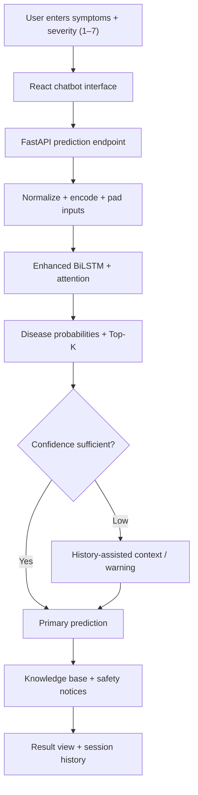
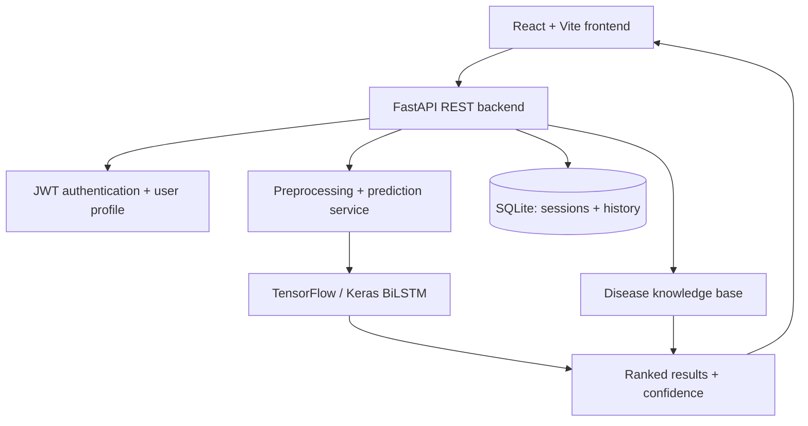

<div align="center">

# 🩺 A Smart Chatbot System for Diagnosing Diseases

### Severity-Aware Deep Learning for Preliminary Disease Prediction

**From reported symptoms to explainable, safety-conscious prediction support.**

An end-to-end AI research and software engineering project combining an enhanced **BiLSTM**, symptom severity encoding, confidence-aware inference, a disease knowledge base, and an interactive web chatbot.

[](#project-information)
[](#research-overview)
[](#model-architecture)
[](#technology-stack)

**[Overview](#research-overview) · [Features](#system-capabilities) · [Model](#model-architecture) · [Evaluation](#dataset--experimental-evaluation) · [Run locally](#getting-started)**

</div>

> [!IMPORTANT]
> **Medical safety:** This is an **educational and research prototype** for preliminary symptom-based prediction. It is **not** a clinically validated diagnostic device, cannot confirm or rule out a condition, and must not be used instead of professional medical evaluation or emergency care.

---

## Project information

| | |
| --- | --- |
| **Official title** | A Smart Chatbot System for Diagnosing Diseases |
| **Research area** | Artificial Intelligence in Healthcare |
| **Academic program** | B.Sc. Artificial Intelligence and Robotics |
| **Institution** | Al-Balqa Applied University |
| **Author** | **Toqa Mahmoud Tawfiq Al-Zoubi** |
| **Supervisor** | **Prof. Abdelwadood Mesleh** |
| **Version** | v1.0 — Final Release |
| **Copyright** | © 2026 Toqa Mahmoud Tawfiq Al-Zoubi |

## Research overview

Many symptom-checking systems rely on a simple list of symptoms. This project explores whether combining **symptom identity** and **reported severity** in a deep learning model can provide more informative preliminary disease predictions.

The application is designed as a complete workflow — not just a trained notebook. It connects a predictive model to a web interface, secured user accounts, session history, knowledge-base descriptions, and cautionary messages for uncertain results.

### The central research idea

**Symptoms + severity → enhanced BiLSTM → disease probabilities → confidence-aware response**

A prediction response can include:

- A predicted disease category and its model confidence
- Ranked alternative disease candidates (**Top-K**)
- Disease information and general precautions retrieved from a knowledge base
- Low-confidence warnings and basic severity-oriented safety notices
- Session history and history-assisted support when prediction confidence is low

## System capabilities

| Area | Functionality |
| --- | --- |
| 👤 **Accounts & profiles** | Registration, login, JWT-based authentication, and profile management |
| 💬 **Symptom chatbot** | User-friendly input of symptoms and individual severity values |
| 🧠 **Prediction engine** | Enhanced BiLSTM classification and ranked disease probabilities |
| 📊 **Confidence awareness** | Confidence scores, alternative predictions, and uncertainty warnings |
| 🧩 **History-assisted prediction** | Uses relevant prior symptoms as fallback context under a low-confidence condition |
| 📖 **Knowledge base** | Retrieves disease descriptions and general precaution information |
| ⚠️ **Safety signals** | Severity-based notices and guidance to seek professional attention when appropriate |
| 🗃️ **History & sessions** | Stores sessions and earlier prediction results |
| 🌐 **Web application** | React frontend connected to a FastAPI REST backend |

## How the system works



### Confidence-aware behavior

The implementation uses a decision threshold for history-assisted fallback when the primary prediction confidence is below **0.35**. Previously reported symptoms can be combined while filtering duplicates and avoiding dependence on the order in which the user entered them.

The resulting confidence is a **model output**, not a calibrated clinical probability.

## Model architecture

The final prediction engine uses an enhanced **Bidirectional Long Short-Term Memory (BiLSTM)** network.

| Component | Purpose |
| --- | --- |
| **Symptom embeddings** | Convert categorical symptom tokens into trainable vector representations |
| **Severity channel** | Encode severity values alongside symptom information |
| **Stacked BiLSTM layers** | Learn bidirectional representations of the encoded input |
| **Attention mechanism** | Weight learned representations for classification |
| **Residual / normalization layers** | Support representation flow and training stability |
| **Regularization** | Dropout, recurrent dropout, and L2 penalty to reduce overfitting |
| **Classification head** | Produce probabilities across the supported disease categories |

The documented stacked recurrent layers use **128** and **64** units.

### Training configuration

| Setting | Value |
| --- | --- |
| Optimizer | Adam |
| Learning rate | `0.001` |
| Batch size | `64` |
| Epochs | `156` |
| Dropout | `0.4` |
| Recurrent dropout | `0.3` |
| L2 regularization | `0.0005` |

The research workflow also explored **Simple RNN**, **Vanilla LSTM**, and **Deep LSTM** baselines before selecting the enhanced architecture.

## Dataset & experimental evaluation

### Dataset profile

| Property | Reported value |
| --- | ---: |
| Samples | **4,920** |
| Disease categories | **41** |
| Unique symptoms | **132** |
| Maximum symptom positions | **17** |
| Symptom vocabulary including special tokens | **134** |
| Severity input range | **1–7** |

### Order-independent strict split

The dataset was partitioned using symptom–severity pattern grouping to avoid placing equivalent patterns, with different input orders, on both sides of the training/test boundary.

| Partition | Samples | Unique pattern groups |
| --- | ---: | ---: |
| Training | 3,193 | 215 |
| Validation | 960 | 45 |
| Test | 767 | 45 |
| **Total** | **4,920** | **305** |

**Reported group overlap between partitions: zero.**

### Reported model results

| Evaluation | Result |
| --- | ---: |
| Strict held-out test accuracy | **100%** (767 / 767) |
| 4-fold group K-fold mean accuracy | **99.04%** |
| 4-fold group K-fold mean macro F1 | **98.67%** |
| Top-2 / Top-3 / Top-5 on strict test | **100%** |

> [!NOTE]
> These are **internal experimental results on the project's curated dataset**, not estimates of diagnostic performance on real patients. The small number of distinct symptom–severity patterns, dataset provenance, class coverage, severity assumptions, calibration, and external validation are important limitations. Such results must not be interpreted as clinical accuracy.

## Full-stack architecture



### Technology stack

| Layer | Technologies |
| --- | --- |
| **Deep learning** | Python, TensorFlow, Keras, BiLSTM, Attention |
| **Backend** | FastAPI, Uvicorn, Pydantic |
| **Frontend** | React, Vite, Axios, React Router DOM |
| **Persistence** | SQLite |
| **Security & configuration** | JWT, bcrypt, python-dotenv |
| **API exploration** | OpenAPI / Swagger UI |

## Repository layout

```text
Backend/
├── artifacts/            # Model and preprocessing artifacts
├── data/                 # Data files
├── DiagnoSeq/             # Model-related project material
├── docs/                 # Technical documents and project notes
├── Frontend/             # React/Vite application
├── src/
│   ├── api/              # HTTP endpoints
│   ├── artifacts/
│   ├── chatbot/
│   ├── core/
│   ├── knowledge_base/
│   ├── ml/
│   ├── models/
│   ├── preprocessing/
│   ├── repositories/
│   ├── schemas/
│   ├── services/
│   └── visualization/
├── tests/
├── .gitignore
├── README.md
├── requirements.txt
└── run.py
```

**Security note:** Local environments and secrets (such as `.venv/` and `.env`) should remain untracked.

## Core application modules

| Module | Responsibility |
| --- | --- |
| **Authentication** | Registration, password hashing, login, and token handling |
| **Profile** | User information and account-associated session context |
| **Preprocessing** | Symptom normalization, encoding, severity processing, and padding |
| **Prediction** | BiLSTM inference, confidence scores, and ranked alternatives |
| **History** | Stored sessions, previous results, and history-assisted context |
| **Knowledge base** | Disease descriptions, precautions, and supporting information |
| **API** | Request validation and communication with the React frontend |

## Getting started

### Requirements

- Python **3.10**
- Node.js and npm (for the frontend)
- The trained model and preprocessing artifacts required by the backend

### 1 · Backend setup

From the `Backend` directory, create a virtual environment and install dependencies.

**Windows PowerShell**

```powershell
py -3.10 -m venv .venv
.\.venv\Scripts\Activate.ps1
pip install -r requirements.txt
```

**macOS / Linux**

```bash
python3.10 -m venv .venv
source .venv/bin/activate
pip install -r requirements.txt
```

Configure any project-required environment variables and artifact paths before starting the server. **Never commit real secrets to GitHub.**

Start the backend with either of the documented entry points:

```bash
python run.py
```

Or:

```bash
uvicorn src.api.main:app --reload
```

Backend / interactive API documentation (when running on port 8000):

**http://localhost:8000/docs**

### 2 · Frontend setup

In a second terminal, open the React application directory:

```bash
cd Frontend
npm install
npm run dev
```

Vite commonly starts at **http://localhost:5173**. Confirm the displayed URL and the frontend's configured API base URL in your local environment.

### 3 · Try the workflow

1. Register or sign in.
2. Open the chatbot and enter symptoms.
3. Select severity values for the symptoms.
4. Request a prediction and examine the top candidates.
5. Read the result's uncertainty notices and general disease information.
6. Review the saved session and prediction history.

## Research limitations & responsible use

- **Not a diagnosis:** Symptom patterns can overlap across many unrelated conditions.
- **Dataset coverage:** The model predicts only among classes represented by its training setup.
- **Severity assumptions:** The meaning and source of severity values require careful documentation.
- **Confidence limitations:** Softmax-like model confidence is not proof of medical likelihood.
- **General precautions:** Knowledge-base advice is informational, not patient-specific treatment.
- **No clinical validation:** Deployment as a real medical device would require extensive external and clinical evaluation, safety engineering, and regulatory review.

For urgent symptoms, users should seek appropriate professional or emergency medical care instead of relying on chatbot output.

## Authorship & academic attribution

**System design and implementation presented in this repository:**  
**Toqa Mahmoud Tawfiq Al-Zoubi**

**Academic supervisor:**  
**Prof. Abdelwadood Mesleh**

The repository documents work across architecture, data preprocessing, model implementation, prediction APIs, frontend/backend integration, authentication, persistence, testing, and technical documentation.

## Copyright & license

**Copyright © 2026 Toqa Mahmoud Tawfiq Al-Zoubi. All Rights Reserved.**

Unauthorized copying, redistribution, modification, publication, reproduction, or use of this project, in whole or in part, without prior written permission from the author is prohibited.

This repository is maintained as the official implementation archive of the graduation project:

**“A Smart Chatbot System for Diagnosing Diseases” — v1.0 Final Release**

---

<div align="center">

### 🩺 AI Research · Healthcare Support · Full-Stack Engineering

*Exploring how intelligent models can become accessible, responsible software systems.*

**Toqa Mahmoud Tawfiq Al-Zoubi** · 2026

</div>

